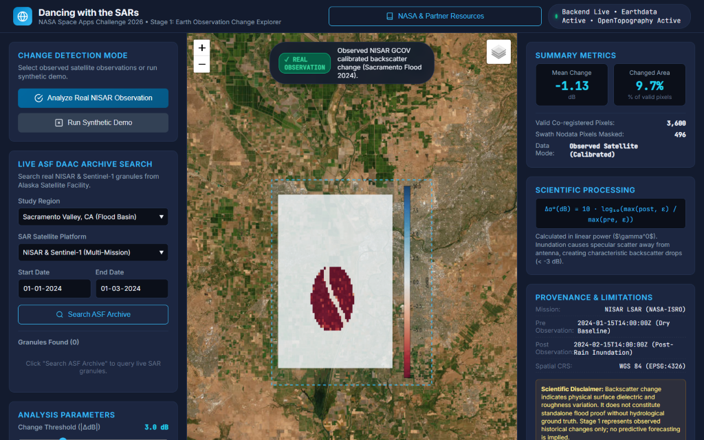
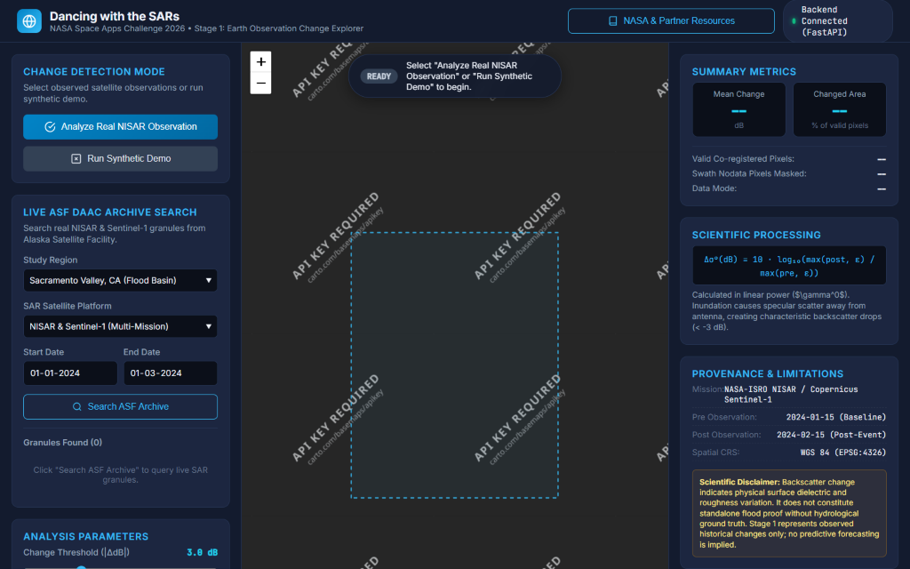

# 🛰️ Dancing with the SARs — Earth Observation Change Explorer
**NASA Space Apps Challenge 2026**

[](https://www.python.org/downloads/)
[](https://fastapi.tiangolo.com/)
[](https://threejs.org/)
[](https://opensource.org/licenses/MIT)

> An interactive 3D globe for exploring **real** Sentinel-1 and NASA-ISRO NISAR SAR acquisitions and NASA OPERA surface-water imagery over six flood-prone study sites.



*Screenshot from an earlier build (v0.2 change-detection overlay).*

---

## ✨ What it does

Pick a site, press **Fly to site**, and the app:

1. **Builds a live timeline** of real SAR acquisitions from ASF DAAC (`GET /api/timeline`) with a From / To range, revisit statistics, orbit pass/track and full granule metadata.
2. **Animates real NASA imagery** (`GET /api/gibs`, no API key): one frame per Sentinel-1 date, from
   * **SAR backscatter** — `OPERA_L2_Radiometric_Terrain_Corrected_SAR_Sentinel-1` (unmodified),
   * **Water** — `OPERA_L3_Dynamic_Surface_Water_Extent-Sentinel-1` (unmodified; optional MODIS true-colour underneath),
   * **Change** — *computed* new / lost / unchanged water between consecutive valid frames, only on pixels valid in both (clearly labelled as derived).
3. Reports per-frame coverage, open-water and inundated-vegetation area (km²) and a time-series chart that marks partial-swath frames. Dates with no NASA product are shown as such — **nothing is ever filled in or fabricated**.

The previous Leaflet explorer (`/classic/`) and the HDF5 change-detection API (`POST /api/analyze`) are still included.

### Sites
Prayagraj (India) · Sacramento Valley (USA) · Padma-Meghna Delta (Bangladesh) · Mississippi Delta (USA) · Pantanal (Brazil) · Valencia / Albufera (Spain).

## 🔬 Scientific principles

1. **Observation vs. simulation are never mixed.** The bundled HDF5 pair is *generated* (`create_sample_nisar_pair.py`) and is returned as `mode="sample"`; `observed` is reserved for real files in `SAR_DATA_DIR`; `synthetic` only on explicit request.
2. **True log-ratio radar maths** on calibrated linear power:
   $$\Delta\sigma^0_{\text{dB}} = 10 \cdot \log_{10}\left(\frac{\max(\gamma^0_{\text{post}}, \epsilon)}{\max(\gamma^0_{\text{pre}}, \epsilon)}\right)$$
   Inundation causes specular reflection away from the sensor, i.e. a backscatter drop (< −3 dB).
3. **NoData isolation:** `0`, `NaN`, `Inf` are masked before any statistic is computed.
4. **Georeferencing** from a geotransform attribute, or from `xCoordinates`/`yCoordinates` when present (real NISAR GCOV layout).

## 🚀 Quickstart

Requires Python 3.10+.

```bash
git clone https://github.com/Naman84789/dancing-with-the-sars.git
cd dancing-with-the-sars
./run.sh          # Linux / macOS     (Windows: run.bat)
```
Then open **http://localhost:8000**. Manual start:

```bash
cd backend
pip install -r requirements.txt
python -m uvicorn main:app --host 127.0.0.1 --port 8000
```

Optional: `cp backend/.env.example backend/.env` and set `EARTHDATA_TOKEN` (ASF search is public; a stale token is automatically ignored).

### Tests (30)
```bash
cd backend
pip install -r requirements-dev.txt
PYTHONPATH=. pytest -v          # Windows PowerShell: $env:PYTHONPATH="."; python -m pytest -v
```
All upstream calls (ASF, GIBS) are mocked, so the suite needs no network.

### Docker / deployment
```bash
docker build -t dancing-with-the-sars .
docker run -p 8000:8000 -e CORS_ORIGINS="https://your-site.example" dancing-with-the-sars
```
The container honours `$PORT` (Render, Railway, Fly, Cloud Run, Heroku-style hosts) and serves the frontend and API from one origin. A GitHub Actions workflow (`.github/workflows/ci.yml`) runs the tests on Python 3.10 and 3.12.

| Variable | Purpose |
|:--|:--|
| `EARTHDATA_TOKEN` | Optional NASA Earthdata bearer token |
| `SAR_DATA_DIR` | Extra directory from which `/api/analyze` may read real HDF5 files |
| `CORS_ORIGINS` | Comma-separated allowed origins (default `*`; only needed for a separately hosted frontend) |
| `PORT` | Listen port for `run.sh` / `run.bat` / Docker |

## 🔌 API

| Method | Endpoint | Description |
|:--|:--|:--|
| `GET` | `/api/health` | Status, version, token configuration flags |
| `GET` | `/api/sites` | The six study sites (id, bbox, description) |
| `GET` | `/api/timeline?site=<id>&start=&end=` | Live ASF acquisitions (Sentinel-1 + NISAR), sorted, de-duplicated, cached 15 min. Default: last 12 months; max 3 years |
| `GET` | `/api/gibs?layer=rtc\|wtr\|true&bbox=&date=YYYY-MM-DD&size=` | Unmodified NASA GIBS PNG (bbox ≤ 2°). `404` = no imagery that day, `502` = NASA outage |
| `GET` | `/api/search` | Raw GeoJSON search of ASF DAAC |
| `POST` | `/api/analyze` | Log-ratio change detection on HDF5 pairs (`sample` / `observed` / `synthetic`) |

## 🛡️ Security & robustness

* File arguments are restricted to `sample_data/` or `SAR_DATA_DIR`; polarization, bbox, dates, platform and threshold are validated.
* Upstream failures are retried once and reported honestly (`502`), never as empty data; error text no longer leaks internals; security headers and gzip are enabled.
* The frontend escapes all server-provided text, only links `http(s)` URLs, aborts hung image requests after 60 s, retries transient failures, and cannot be frozen by a render error.

## 🏛️ Layout

```text
├── backend/
│   ├── main.py                     # FastAPI app, routes, static hosting
│   ├── asf_client.py               # ASF DAAC search + per-site timeline
│   ├── gibs_client.py              # NASA GIBS WMS proxy (cached)
│   ├── sar_processor.py            # HDF5 reader, log-ratio maths, PNG renderer
│   ├── create_sample_nisar_pair.py # Reproducible simulated NISAR-format pair
│   ├── sample_data/  tests/  requirements*.txt  .env.example
├── frontend/
│   ├── index.html                  # 3D globe explorer (Three.js, vendored)
│   ├── classic/                    # Earlier Leaflet explorer
│   ├── assets/textures/  vendor/
├── Dockerfile  run.sh  run.bat  .github/workflows/ci.yml
└── assets/                         # Documentation images
```

---

## 📚 Official NASA & Partner Resources Hub



> **Official Disclaimer:** NASA does not endorse any non-U.S. Government entity and is not responsible for information contained on non-U.S. Government websites. For non-U.S. Government websites, participants must comply with any data use parameters of that specific website.

### Integrated Resources:
* **NASA Data & Science**:
  * [NASA Earthdata Search](https://search.earthdata.nasa.gov/search)
  * [ASF Data Search Vertex](https://search.asf.alaska.edu/)
  * [NISAR Data User Guide](https://nisar-docs.asf.alaska.edu/)
  * [Intro to Synthetic Aperture Radar (SAR)](https://www.earthdata.nasa.gov/learn/earth-observation-data-basics/sar)
  * [NASA ARSET SAR & Disaster Management Trainings](https://appliedsciences.nasa.gov/get-involved/training)
  * [NISAR StoryMaps](https://nisar.jpl.nasa.gov/applications/arcgis-storymaps/)
  * [NASA UAVSAR Postcards](https://uavsar.jpl.nasa.gov/education/postcards.html)
* **Canadian Space Agency (CSA)**:
  * [RADARSAT Constellation Mission (RCM)](https://donnees-data.asc-csa.gc.ca/en/dataset/rcm)
  * [Synthetic Aperture Radar Python Tutorial](https://github.com/asc-csa/Synthetic_Aperture_Radar_Tutorial)
  * [RADARSAT-1 Open Data Archive](https://donnees-data.asc-csa.gc.ca/en/dataset/radarsat1)
* **National Space Activities Commission of Argentina (CONAE)**:
  * [SAOCOM Catalogue (L-band SAR)](https://catalogos.conae.gov.ar/catalogo/catalogoSatSaocomInfo.html)
  * [SAOCOM Catalogue Registration](https://www.argentina.gob.ar/noticias/la-informacion-saocom-cada-vez-mas-accesible)

---

## 📄 License
This project is licensed under the [MIT License](LICENSE).
